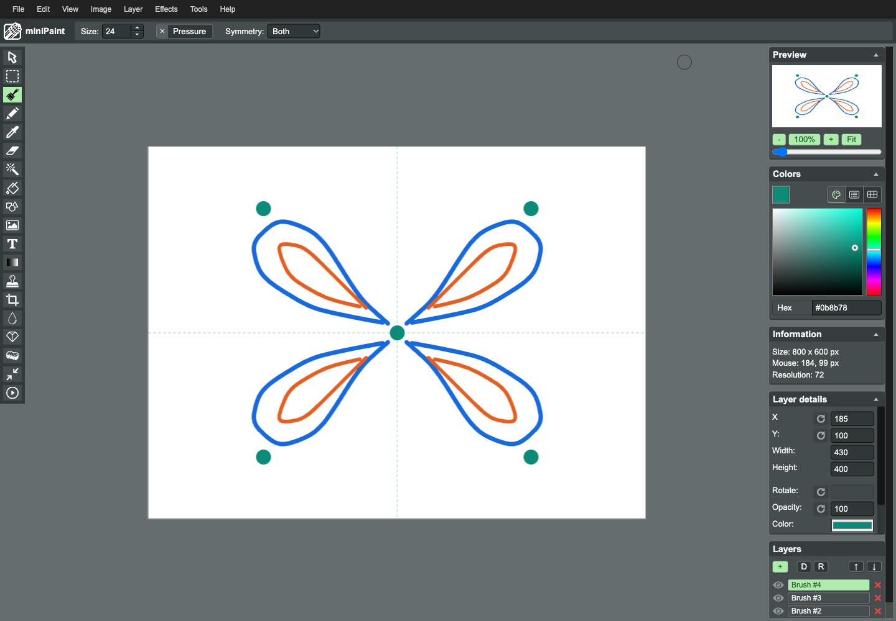

# miniPaint Symmetry Brush

CS361 Homework 5 Part 5: a symmetry brush added to [miniPaint](https://github.com/viliusle/miniPaint), an MIT-licensed browser image editor by Vilius L. and its contributors. This repository contains the modified application, regression tests, and sample artwork. Development and verification were assisted by OpenAI Codex.

## Added feature

Select **Brush**, then choose **Off**, **Vertical**, **Horizontal**, or **Both** from the Symmetry control. Reflections use the canvas center, each gesture is one undo/redo action, and dashed guides stay out of exported images. Projects retain ordinary brush data and remain compatible with the original application.



## Run locally

The verified environment used Node.js 22.12.0 and npm 10.9.0.

```sh
git clone https://github.com/pranay-dinesh/minipaint-symmetry-brush.git
cd minipaint-symmetry-brush
npm ci --engine-strict
npm run build
python3 -m http.server 4173 --bind 127.0.0.1
```

Open <http://127.0.0.1:4173>. The committed `dist/` build can also be served without rebuilding. To try the sample artwork, open [symmetry-project.json](examples/symmetry-project.json) from the application's File menu.

## Verification

```sh
node tests/symmetry/node-regression.cjs
```

The automated suite contains 40 logic checks against the actual brush and history modules, with explicit browser/GUI doubles. It writes a local result file beside the test script. Additional implementation verification exercised 13 Chrome browser scenario groups, the production build, and PNG/project compatibility; those private session logs and homework reports are not part of this public source repository.

Browser coverage was macOS Chrome. Physical stylus and native multitouch hardware remain unverified, and large-canvas stress and all filter/blend combinations were not exhaustively tested. A pre-existing export-dialog callback error can occur after closing the dialog; actual downloads succeeded during verification.

## Attribution

Based on upstream miniPaint commit [`c9192c15918eb61f7dd89e362cf8065a276b89e9`](https://github.com/viliusle/miniPaint/commit/c9192c15918eb61f7dd89e362cf8065a276b89e9). Original source history, package attribution, and [MIT-LICENSE.txt](MIT-LICENSE.txt) are retained. The original project README follows.

---

# miniPaint

Online image editor lets you create and edit images using HTML5 technologies. No need to buy, download, install, or have outdated flash. No ads. Key features: layers, filters, open source Photoshop alternative.

miniPaint operates directly in the browser. You can create images by pasting from the clipboard (ctrl+v) or uploading from the computer (_using menu or drag & drop_). Nothing will be sent to any server. Everything stays in your browser. 

## URL:
**https://viliusle.github.io/miniPaint/**

## Preview:

(generated using miniPaint)

**Change log:** [/miniPaint/releases](https://github.com/viliusle/miniPaint/releases)

## Browser Support
- Chrome
- Firefox
- Opera
- Edge
- Safari
- Yandex

## Features

**Files**: open images, directories, URLs, data URLs, drag and drop, save (PNG, JPG, BMP, WEBP, animated GIF, TIFF, JSON (layers data), print.

**Edit**: undo, cut, copy, paste, selection, paste from the clipboard.

**Image**: information, EXIF, trim, zoom, resize (Hermite resample, default resize), rotate, flip, color corrections (brightness, contrast, hue, saturation, luminance), automatic color adjustment, grid, histogram, negative.

**Layers**: multi-layer system, differences, merging, flattening, transparency support.

**Effects**: black and white, blur (box, gaussian, stack, zoom), bulge/pinch, denoise, desaturation, dither, dot screen, edge, emboss, enrich, gamma, grains, grayscale, heatmap, jpg compression, mosaic, oil, sepia, sharpen, solarize, tilt shift, vignette, vibrance, vintage, blueprint, night vision, pencil, also instagram filters: 1977, aden, clarendon, gingham, inkwell, lo-fi, toaster, valencia, x-pro ii.

**Tools**: pencil, brush, magic wand, eraser, fill, color picker, letter, crop, blur, sharpener, desaturation, clone, borders, sprites, keypoints, color zoom, change color, restore transparency, content fill. 

**Help**: keyboard shortcuts, translation.

## Embed
To embed this app on another page, use the following HTML code:

    <iframe style="box-sizing:border-box; width:100%; height:100vh;" id="miniPaint" src="https://viliusle.github.io/miniPaint/" allow="accelerometer; autoplay; clipboard-write; encrypted-media; gyroscope; picture-in-picture; web-share" allowfullscreen></iframe>

## Build instructions
See [Wiki > Build instructions](https://github.com/viliusle/miniPaint/wiki/Build-instructions)

## Wiki
See [Wiki](https://github.com/viliusle/miniPaint/wiki)

## Contributors
<a align="center" href="https://github.com/viliusle/miniPaint/graphs/contributors">
  
</a>

## License
MIT License

## Support
Please use the GitHub issues for support, feature requests and bug reports, or contact us by sending an email to www.viliusl@gmail.com.
